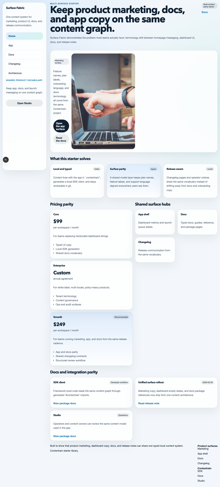
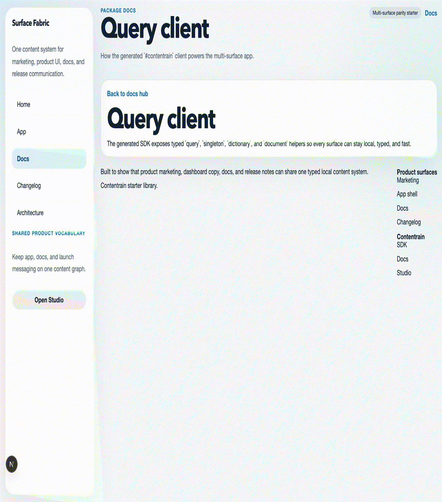

<p align="center"></p>



# Contentrain Next Multi-Surface SaaS

A Next.js (App Router) starter for a SaaS product whose marketing site, app shell, docs and changelog read from one
content model in `.contentrain/`. Contentrain is a content governance ecosystem for teams and AI agents: models, content
and the generated client live in git next to the code, so the copy on every surface changes through the same reviewable
commits.



## What it shows

- **Marketing** (`/`, `/billing`): hero, features, integrations, pricing tiers and the latest changelog entry.
- **App shell** (`/app`, `/operations`, `/settings`): dashboard overview, stats, a work queue and settings groups, with
  interface labels from a `ui-copy` dictionary.
- **Docs** (`/docs`, `/docs/[slug]`, `/guides/[slug]`, `/reference/[slug]`, `/packages/[slug]`): Markdown document models
  whose files live in `docs/`, rendered from their `body`.
- **Changelog** (`/changelog/[slug]`): a Markdown document model.
- An `/architecture` page that lists every model by domain, read from `.contentrain/models/`.

Every page reads content in React Server Components through the generated `#contentrain` client
(`@contentrain/query`). The queries are synchronous, with no runtime API calls.

## Use this template

Click **Use this template** on GitHub to create your own repository. You can also start from
[Contentrain Studio](https://contentrain.io/studio): choose this starter under "Start from a starter" and Studio creates
the repository from the template and connects it as a project, ready to edit.

## Quick start

Node 22 and pnpm 10:

```bash
pnpm install
pnpm dev        # http://localhost:3000
```

| Command | What it does |
|---|---|
| `pnpm dev` | Next.js dev server |
| `pnpm build` | Production build (all pages are prerendered) |
| `pnpm start` | Serve the production build |
| `pnpm check` | TypeScript check |
| `pnpm validate` | Validate `.contentrain/` against its models |
| `pnpm contentrain:generate` | Regenerate the typed client in `.contentrain/client/` after a model or content change |

CI (`.github/workflows/ci.yml`) runs install, validate, check and build on every push and pull request.

## Content model

| Model | Kind | Domain | Entries | Fields |
|---|---|---|---|---|
| `hero` | singleton | marketing | 1 | `eyebrow`, `title`, `subtitle`, `primary_cta_label`, `primary_cta_href`, `secondary_cta_label`, `secondary_cta_href`, `hero_media` |
| `feature` | collection | marketing | 3 | `title`, `summary`, `icon`, `emphasis` |
| `pricing-tier` | collection | marketing | 3 | `name`, `price_label`, `billing_hint`, `summary`, `features`, `featured` |
| `integration` | collection | product | 2 | `name`, `slug`, `category`, `summary`, `icon` |
| `changelog-entry` | document | product | 1 | `title`, `slug`, `release_date`, `summary` + Markdown body |
| `dashboard-overview` | singleton | app | 1 | `eyebrow`, `title`, `summary`, `environment_badge`, `status_note`, `primary_cta_label`, `primary_cta_href` |
| `dashboard-stat` | collection | app | 3 | `label`, `value`, `delta`, `trend`, `note` |
| `work-queue-item` | collection | app | 3 | `title`, `summary`, `owner`, `priority`, `status`, `due_label`, `href` |
| `settings-group` | collection | app | 2 | `title`, `summary`, `items` |
| `ui-copy` | dictionary | app | 4 keys | interface labels |
| `docs-page` | document | docs | 2 | `title`, `slug`, `description`, `sidebar_label`, `order`, `layout` + Markdown body in `docs/` |
| `guide-page` | document | guides | 1 | `title`, `slug`, `description`, `sidebar_label`, `order` + Markdown body in `docs/guides/` |
| `reference-page` | document | reference | 1 | `title`, `slug`, `description`, `sidebar_label`, `order` + Markdown body in `docs/reference/` |
| `package-page` | document | packages | 1 | `title`, `slug`, `description`, `sidebar_label`, `order` + Markdown body in `docs/packages/` |
| `navigation` | singleton | system | 1 | `announcement_label`, `items`, `cta_label`, `cta_href` |
| `footer` | singleton | system | 1 | `blurb`, `columns`, `legal_notice` |
| `seo-defaults` | singleton | system | 1 | `meta_title`, `meta_description`, `canonical_base`, `og_image` |
| `site-settings` | singleton | system | 1 | `site_name`, `site_tagline`, `theme_name`, `default_locale`, `og_image` |

Models are in `.contentrain/models/`. JSON content is in `.contentrain/content/<domain>/<model>/`; the docs models'
Markdown files are in `docs/`.

## Deploy

`netlify.toml` is committed: the build command is `pnpm deploy:netlify` and Netlify detects the Next.js runtime, so leave
the publish directory empty.

[](https://app.netlify.com/start/deploy?repository=https%3A%2F%2Fgithub.com%2FContentrain%2Fcontentrain-starter-next-multi-surface-saas)

Any host that runs Next.js works the same way (`pnpm build`, then `pnpm start`).

## Contentrain

Contentrain has four parts: the open-source tools, Studio, Migrate and Bridge.

- Packages, CLI and agent tooling: [ai.contentrain.io](https://ai.contentrain.io)
- Next.js guide: [ai.contentrain.io/guides/frameworks#next-js-app-router](https://ai.contentrain.io/guides/frameworks#next-js-app-router)
- Query SDK: [ai.contentrain.io/packages/sdk](https://ai.contentrain.io/packages/sdk)
- Contentrain Studio: [contentrain.io/studio](https://contentrain.io/studio)
- Open-source tools (MIT): [github.com/Contentrain/ai](https://github.com/Contentrain/ai)
- Migrate, WordPress to Astro: [migrate.contentrain.io](https://migrate.contentrain.io)
- Bridge, a free WordPress plugin that exports content as a Contentrain store: [github.com/Contentrain/wordpress-bridge](https://github.com/Contentrain/wordpress-bridge)

## License

[MIT](./LICENSE)
